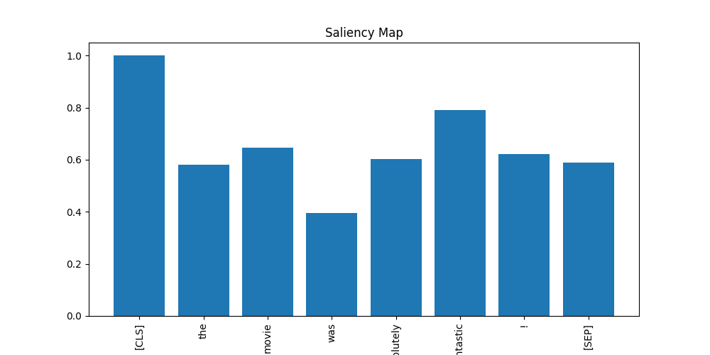
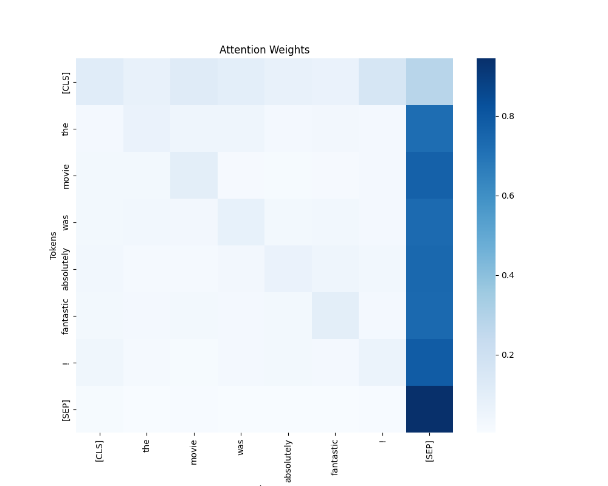

# [WIP] Model Understanding with Saliency and Attention Mapping

This repository provides tools for exploring and understanding transformer-based models using saliency maps and attention visualizations. By analyzing saliency and attention, users can gain insights into how models make predictions or generate text, which helps in debugging and interpreting model behavior.

## Features

- **Saliency Maps**: Visualize token importance by computing gradients of the input with respect to model outputs.
- **Attention Visualizations**: Plot attention scores to understand token-to-token interactions.
- **Support for Classification Models**: Works with `AutoModelForSequenceClassification` from the Hugging Face Transformers library.
- **Support for Generative Models**: Compatible with `AutoModelForCausalLM` for analyzing autoregressive text generation.
- **Support for Sequence-to-Sequence Models**: Works with `AutoModelForSeq2SeqLM` for encoder-decoder models like MarianMT and NLLB.
- **Support for Token Classification Models**: Works with `AutoModelForTokenClassification` (e.g. NER, POS tagging).
- **Support for Question Answering Models**: Works with `AutoModelForQuestionAnswering` for extractive QA.
- **Deeper Attribution & Interpretability**: Integrated Gradients (via Captum), logit lens, attention rollout, and attention entropy/distance metrics, on top of raw saliency and attention.
- **Custom Visualizations**: Generate bar plots for saliency scores and heatmaps for attention weights.

## Installation

Clone the repository and install the required dependencies:

```bash
git clone https://github.com/sbartlet97/model_understanding.git
cd model_understanding
pip install -r requirements.txt
```

## Usage

### For Classification Models

```python
from model_understanding import ClassificationVisualizer

# Initialize the visualizer with a classification model
visualizer = ClassificationVisualizer("bert-base-uncased")

# Analyze a sample input text
input_text = "The movie was absolutely fantastic!"
visualizer.analyze(input_text)
```

### For Generative Models

```python
from model_understanding import GenerativeVisualizer

# Initialize the visualizer with a generative model
gen_visualizer = GenerativeVisualizer("gpt2")

# Analyze a sample prompt
prompt = "Once upon a time in a land far away,"
gen_visualizer.analyze(prompt)
```

### For Sequence-to-Sequence Models

```python
from model_understanding import Seq2SeqVisualizer

# Initialize the visualizer with a seq2seq model
translator = Seq2SeqVisualizer("Helsinki-NLP/opus-mt-en-fr")

# Analyze a sample input text
input_text = "Hello, how are you?"
translator.analyze(input_text)
```

### For Token Classification Models

```python
from model_understanding import TokenClassificationVisualizer

# Initialize the visualizer with a token classification model (e.g. NER)
visualizer = TokenClassificationVisualizer("dslim/bert-base-NER")

# Analyze a sample input text
input_text = "John lives in New York."
visualizer.analyze(input_text)
```

### For Question Answering Models

```python
from model_understanding import QuestionAnsweringVisualizer

# Initialize the visualizer with an extractive QA model
qa_visualizer = QuestionAnsweringVisualizer("deepset/roberta-base-squad2")

# Analyze a sample question/context pair
question = "Where does John live?"
context = "John lives in New York."
qa_visualizer.analyze(question, context)
```

### Outputs

1. **Saliency Map**: A bar plot showing the relative importance of each token in the input.
2. **Attention Weights**: A heatmap displaying token-to-token attention scores.

### Additional Analysis Methods

Beyond `analyze()`, every visualizer also exposes opt-in methods for deeper interpretability techniques (not run automatically, since they're more expensive than the default saliency/attention pass):

- `compute_integrated_gradients(text)` (`ClassificationVisualizer`, `GenerativeVisualizer`) - a more faithful attribution method than raw gradient saliency, via [Captum](https://captum.ai/).
- `compute_logit_lens(prompt)` (`GenerativeVisualizer`) - shows what token the model would predict if generation stopped at each layer.
- `compute_attention_rollout()` / `compute_attention_entropy_distance()` (all visualizers, after calling `compute_attention`) - composes attention across layers to show indirect attention paths, and quantifies how focused/diffuse and local/long-range each attention head is.
- `compute_activation_patch(clean_text, corrupted_text, layer, position)` / `compute_activation_patch_sweep(clean_text, corrupted_text)` (`ClassificationVisualizer`, `GenerativeVisualizer`) - activation patching / causal tracing: measures how much a single layer's hidden state at one token position causally determines the model's prediction, by splicing a corrupted run's activation into a clean run and checking how far the output moves.
- `compute_faithfulness(attributions, *texts)` / `plot_faithfulness(results)` (all visualizers) - scores any per-token attribution (saliency, Integrated Gradients) with comprehensiveness and sufficiency (DeYoung et al., ERASER). It removes the top-ranked tokens, or keeps only them, and measures how much the model's probability for its prediction drops. Compare the result with a random ranking.

See `CLAUDE.md` for the full method reference.

## Implementation Details

### ClassificationVisualizer

This class handles models for classification tasks. It computes saliency maps by backpropagating gradients through the model and extracts attention weights from the last layer.

- **Methods**:
  - `compute_saliency`: Computes normalized gradients for input tokens.
  - `compute_attention`: Averages attention scores across heads.
  - `plot_saliency`: Visualizes saliency as a bar plot.
  - `plot_attention`: Visualizes attention scores as a heatmap.

### GenerativeVisualizer

This class supports autoregressive models like GPT-2. It computes token saliency for the prompt and generates attention heatmaps for decoding steps.

- **Methods**:
  - `compute_saliency`: Uses the loss to compute input token gradients.
  - `compute_attention`: Extracts and averages attention scores across heads.
  - `plot_saliency`: Visualizes saliency as a bar plot.
  - `plot_attention`: Visualizes attention scores as a heatmap.

### Seq2SeqVisualizer

This class supports encoder-decoder models like MarianMT and NLLB. It computes encoder-side saliency for the input tokens and extracts encoder self-attention weights.

- **Methods**:
  - `compute_saliency`: Computes normalized gradients for input tokens against the model's first decoded token.
  - `compute_attention`: Extracts and averages encoder self-attention scores across heads.
  - `plot_saliency`: Visualizes saliency as a bar plot.
  - `plot_attention`: Visualizes attention scores as a heatmap.

### TokenClassificationVisualizer

This class supports token classification models (e.g. NER, POS tagging). It computes one saliency score per input token, reflecting each token's influence on the full sequence-labeling decision.

- **Methods**:
  - `compute_saliency`: Computes normalized gradients for input tokens against every token's own predicted-label logit, summed.
  - `compute_attention`: Averages attention scores across heads.
  - `plot_saliency`: Visualizes saliency as a bar plot.
  - `plot_attention`: Visualizes attention scores as a heatmap.

### QuestionAnsweringVisualizer

This class supports extractive question-answering models. Unlike the other visualizers, it takes a `(question, context)` pair rather than a single text string, so `analyze`, `compute_saliency`, and `compute_attention` all have that two-argument signature.

- **Methods**:
  - `compute_saliency(question, context)`: Computes normalized gradients against the predicted answer span's start + end logits.
  - `compute_attention(question, context)`: Averages attention scores across heads.
  - `analyze(question, context, save_dir=None)`: Runs the full saliency + attention analysis for the pair.
  - `plot_saliency`: Visualizes saliency as a bar plot.
  - `plot_attention`: Visualizes attention scores as a heatmap.

## Example Visualizations

### Saliency Map Example



### Attention Heatmap Example



## Dependencies

- `transformers`
- `torch`
- `captum`
- `matplotlib`
- `seaborn`

## License

This repository is licensed under the MIT License. See the `LICENSE` file for details.

## Contributing

Contributions are welcome! Please feel free to submit issues or pull requests.

